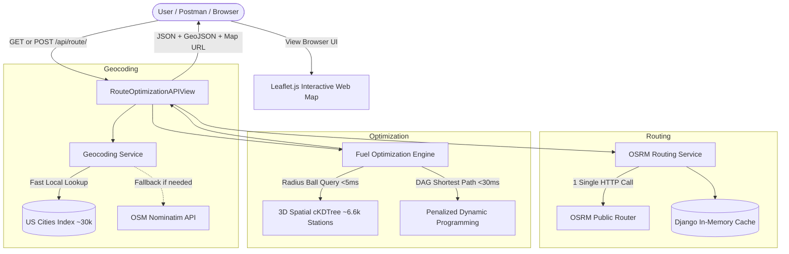

# ⛽ FuelPath AI - Optimal Fuel Routing API & Map Engine

A high-performance Django web application and REST API that calculates driving routes across the USA and determines the **most cost-effective refueling stops** based on real-world retail fuel prices from OPIS.

Built for **latest stable Django (6.x/5.x)**, **Django REST Framework**, and **OSRM Routing Engine**, with an interactive **Leaflet.js** map visualizer, automated **Swagger / OpenAPI** documentation, and a ready-to-import **Postman collection**.

---

## 🌟 Key Features

- **Optimal Fuel Selection**: Uses a **Penalized Dynamic Programming (DAG Shortest Path)** algorithm to select the cheapest fuel stops along the route.
- **Strict Vehicle Range Constraints**: Strictly enforces the vehicle's maximum range (default: **500 miles** on a full tank) and fuel economy (**10 MPG**). No leg between consecutive stops ever exceeds 500 miles.
- **Blazing Fast Performance**:
  - **In-memory 3D Spatial Indexing**: Over 6,600 pre-geocoded US truck stops indexed via `scipy.spatial.cKDTree` on 3D Earth coordinates. Corridor search along a 2,800-mile route takes **under 5 milliseconds**.
  - **DP Optimization**: Finds the global cost-minimum refueling plan in **under 30 milliseconds**.
  - **Local-first Geocoding**: In-memory database of ~30,000 US cities resolves coordinates in **0 ms** without external API rate limits.
- **Minimal External Routing Calls**: Uses **Open Source Routing Machine (OSRM)** public API. **Exactly 1 single API call** is made per route calculation.
- **Rich Interactive Map UI**: A modern dark-mode web dashboard featuring Leaflet.js map, route polyline, origin/destination flags, custom gas-pump markers with badge numbers, KPI cards, step-by-step refueling itinerary, and 1-click route presets.
- **Loom & Postman Ready**: Includes a complete Postman collection (`Fuel_Route_API.postman_collection.json`) and a minute-by-minute Loom video script (`LOOM_WALKTHROUGH.md`).

---

## 🏗️ System Architecture



---

## 🚀 Quick Start

### 1. Prerequisites
- Python 3.10+ (Tested on Python 3.13)
- Git

### 2. Setup Virtual Environment & Install Dependencies
```bash
# Clone or navigate to the repository directory
cd "Django assignment"

# Create virtual environment
python -m venv .venv

# Activate virtual environment
# Windows (PowerShell):
.venv\Scripts\Activate.ps1
# Windows (cmd):
.venv\Scripts\activate.bat
# Linux/macOS:
source .venv/bin/activate

# Install dependencies
pip install -r requirements.txt
```

### 3. Initialize Database & Pre-Geocode Fuel Stations
```bash
# Run migrations
python manage.py migrate

# Load and index fuel stations from CSV into database
python manage.py load_fuel_stations
```

### 4. Run Development Server
```bash
python manage.py runserver 127.0.0.1:8000
```
Open **[http://127.0.0.1:8000/](http://127.0.0.1:8000/)** in your web browser!

---

## 📡 API Reference

### 1. Route & Fuel Optimization Endpoint

**`GET /api/route/`** or **`POST /api/route/`**

#### Query Parameters (GET) / JSON Body (POST):
| Parameter | Type | Required | Default | Description |
| :--- | :--- | :---: | :---: | :--- |
| `start` | string | **Yes** | — | Starting location in the USA (e.g. `'New York, NY'` or `'40.7128,-74.0060'`) |
| `finish` | string | **Yes** | — | Destination in the USA (e.g. `'Los Angeles, CA'` or `'34.0522,-118.2437'`) |
| `max_range` | float | No | `500.0` | Maximum vehicle driving range on a full tank (miles) |
| `mpg` | float | No | `10.0` | Vehicle fuel efficiency (miles per gallon) |
| `max_deviation_miles` | float | No | `10.0` | Maximum corridor search radius off highway path (miles) |

#### Example Request (cURL):
```bash
curl -X GET "http://127.0.0.1:8000/api/route/?start=New+York,NY&finish=Los+Angeles,CA&max_range=500&mpg=10"
```

#### Example Request (POST JSON):
```bash
curl -X POST "http://127.0.0.1:8000/api/route/" \
  -H "Content-Type: application/json" \
  -d '{
    "start": "Chicago, IL",
    "finish": "Miami, FL",
    "max_range": 500,
    "mpg": 10
  }'
```

#### Example Response (Truncated for brevity):
```json
{
  "success": true,
  "start": {
    "query": "New York, NY",
    "display_name": "New York, NY, USA",
    "latitude": 40.7128,
    "longitude": -74.0060
  },
  "finish": {
    "query": "Los Angeles, CA",
    "display_name": "Los Angeles, CA, USA",
    "latitude": 34.0522,
    "longitude": -118.2437
  },
  "total_distance_miles": 2800.62,
  "total_duration_hours": 49.88,
  "total_fuel_gallons": 280.06,
  "total_fuel_cost": 867.35,
  "average_price_per_gallon": 3.097,
  "vehicle_specs": {
    "max_vehicle_range_miles": 500.0,
    "fuel_efficiency_mpg": 10.0,
    "tank_capacity_gallons": 50.0
  },
  "fuel_stops_count": 6,
  "fuel_stops": [
    {
      "stop_number": 1,
      "opis_id": 72445,
      "name": "SHEETZ #639",
      "address": "I-80 Exit 223",
      "city": "Youngstown",
      "state": "OH",
      "retail_price": 3.059,
      "route_mile": 392.1,
      "leg_distance_miles": 392.1,
      "gallons_pumped": 39.2,
      "cost_at_stop": 119.94,
      "miles_off_route": 0.08,
      "latitude": 41.0998,
      "longitude": -80.6495
    },
    {
      "stop_number": 2,
      "opis_id": 70744,
      "name": "CASEYS #3686",
      "address": "I-80 EXIT 81",
      "city": "Utica",
      "state": "IL",
      "retail_price": 2.969,
      "route_mile": 853.7,
      "leg_distance_miles": 461.6,
      "gallons_pumped": 46.2,
      "cost_at_stop": 137.05,
      "miles_off_route": 1.25,
      "latitude": 41.3414,
      "longitude": -89.0115
    },
    {
      "stop_number": 3,
      "opis_id": 68368,
      "name": "AKAL TRAVEL CENTER",
      "address": "I-80 EX 360",
      "city": "Waco",
      "state": "NE",
      "retail_price": 2.799,
      "route_mile": 1335.8,
      "leg_distance_miles": 482.1,
      "gallons_pumped": 48.2,
      "cost_at_stop": 134.91,
      "miles_off_route": 0.45,
      "latitude": 40.8986,
      "longitude": -97.4606
    },
    {
      "stop_number": 4,
      "opis_id": 71301,
      "name": "7-ELEVEN 42279",
      "address": "I-76, Exit 39",
      "city": "Keenesburg",
      "state": "CO",
      "retail_price": 3.149,
      "route_mile": 1739.4,
      "leg_distance_miles": 403.6,
      "gallons_pumped": 40.4,
      "cost_at_stop": 127.13,
      "miles_off_route": 0.32,
      "latitude": 40.1089,
      "longitude": -104.5205
    },
    {
      "stop_number": 5,
      "opis_id": 71712,
      "name": "MAVERIK COUNTRY STORE #693",
      "address": "I-70, Exit 160 & hwy 191",
      "city": "Green River",
      "state": "UT",
      "retail_price": 3.282,
      "route_mile": 2120.9,
      "leg_distance_miles": 381.5,
      "gallons_pumped": 38.1,
      "cost_at_stop": 125.22,
      "miles_off_route": 0.15,
      "latitude": 38.9955,
      "longitude": -110.1596
    },
    {
      "stop_number": 6,
      "opis_id": 72965,
      "name": "Maverik #674",
      "address": "I-15, Exit 45",
      "city": "North Las Vegas",
      "state": "NV",
      "retail_price": 3.282,
      "route_mile": 2498.9,
      "leg_distance_miles": 378.0,
      "gallons_pumped": 37.8,
      "cost_at_stop": 124.07,
      "miles_off_route": 0.40,
      "latitude": 36.1989,
      "longitude": -115.1175
    }
  ],
  "route_geometry": {
    "type": "LineString",
    "coordinates": [
      [-74.006, 40.7128],
      "..."
    ]
  },
  "interactive_map_url": "http://127.0.0.1:8000/?start=New+York%2C+NY&finish=Los+Angeles%2C+CA&range=500.0&mpg=10.0",
  "api_execution_time_ms": 66.04
}
```

---

### 2. Other Available Endpoints
- **`GET /api/stations/?state=TX&limit=25`**: Browse and query the OPIS fuel stations dataset by state or city.
- **`GET /api/health/`**: System and database connectivity health check.
- **`GET /api/docs/`**: Interactive Swagger UI API documentation.
- **`GET /api/schema/`**: OpenAPI 3.0 YAML/JSON specification.

---

## 🧪 Running Automated Tests

A comprehensive test suite of 12 unit and integration tests is included:
```bash
python manage.py test routing
```
**Test Coverage Includes:**
- Coordinate parsing and USA bounding box validation.
- Local in-memory US city geocoding.
- OSRM route parsing.
- Under 500 miles route verification (0 refueling stops).
- Long-distance route refueling (all legs $\le 500$ miles).
- API `GET` and `POST` response validation.
- Missing and invalid parameter error handling.
- Web UI template rendering.

---

## 📽️ Loom Video Recording Guide

A complete 5-minute video presentation outline and script is included in [**`LOOM_WALKTHROUGH.md`**](file:///f:/Stuff/Django%20assignment/LOOM_WALKTHROUGH.md).

### Quick Steps to Record:
1. Ensure the development server is running: `python manage.py runserver`
2. Open Postman and import `Fuel_Route_API.postman_collection.json`.
3. Open `LOOM_WALKTHROUGH.md` and follow the minute-by-minute speaking cues.

---

## 📦 Project Structure

```
├── fuel_routing_project/          # Django Project Configuration
│   ├── settings.py                # Django Settings (DRF, CORS, Spectacular, Caching)
│   ├── urls.py                    # Root URL Routing
│   ├── wsgi.py                    # WSGI Gateway
├── routing/                       # Main Routing Application
│   ├── data_builder.py            # Pre-geocoding builder for fuel stations
│   ├── models.py                  # FuelStation & RouteQueryLog models
│   ├── serializers.py             # DRF Serializers for API request/response
│   ├── views.py                   # RouteOptimizationAPIView, UI & Health Views
│   ├── urls.py                    # App URLs
│   ├── tests.py                   # Automated Test Suite (12 tests)
│   ├── services/                  # Business Logic & Algorithms
│   │   ├── geocoding.py           # Local-first US Geocoder + Nominatim fallback
│   │   ├── osrm.py                # OSRM Driving Route Client + Cache
│   │   └── fuel_optimizer.py      # 3D KD-Tree + Penalized DP Refueling Engine
│   └── management/commands/       # Custom Django Management Commands
│       └── load_fuel_stations.py  # Loads geocoded stations into SQLite
├── data/                          # Geographic Data Assets
│   ├── fuel_stations_geocoded.csv # 6,626 Pre-geocoded US stations
│   └── us_cities.csv              # 29,880 US cities database
├── templates/                     # HTML Templates
│   └── routing/map.html           # Leaflet.js Interactive Web Map & Control Panel
├── static/                        # Static Assets (CSS, JS, Postman Collection)
│   ├── css/style.css              # Modern Dark Aesthetic Design System
│   ├── js/app.js                  # Frontend Controller & Map Rendering
│   └── Fuel_Route_API.postman_collection.json
├── Fuel_Route_API.postman_collection.json # Root Postman Collection for import
├── LOOM_WALKTHROUGH.md            # 5-Minute Loom Video Script
├── fuel-prices-for-be-assessment.csv # Original OPIS Fuel Prices CSV
├── requirements.txt               # Python Dependencies
└── manage.py                      # Django CLI
```

---

## ⚖️ License
MIT License. Built for the Coding Assessment.
